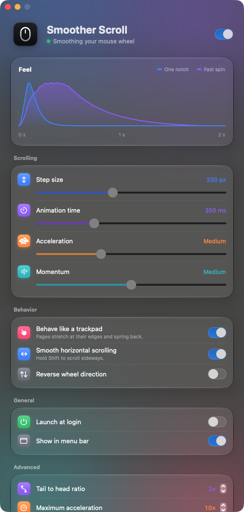

# Smoother Scroll

Makes a mouse wheel on the Mac scroll like a trackpad. A free, open-source alternative to SmoothScroll, under the MIT license.



- **Smooth notches.** Each notch eases in and out over a fixed time, landing exactly its distance, in points instead of lines. Turning the wheel back stops what is left; a wheel bouncing back a tick in a fast spin doesn't.
- **Speed matters.** How fast the wheel spins is measured from the mouse's own timestamps over the last few notches: a notch at a time moves exactly its distance, a fast spin covers far more ground.
- **Like a trackpad, if you want.** Off by default: a fast spin can glide on after the wheel stops, and pages can bounce at their ends.
- **Leaves the rest alone.** Trackpads and the Magic Mouse scroll as they did. Scrolling with ⌘, ⌥ or ⌃ held goes to the app as it was, for zooming. Shift scrolls sideways.
- **Per app.** Turn it off for apps that want the wheel's own steps, like CAD and 3D tools, from the menu bar or the settings.
- **Native.** A menu bar app: its settings drop down from the menu bar, in stock macOS controls. It starts at login.

## Install

Download `SmootherScroll.zip` from the [latest release](https://github.com/yekta/smoother-scroll/releases/latest), unzip it and move **Smoother Scroll** to Applications. Or paste this in Terminal, which does the same and opens it:

```sh
curl -fsSL https://raw.githubusercontent.com/yekta/smoother-scroll/main/scripts/install.sh | sh
```

Then allow it under **System Settings → Privacy & Security → Accessibility**: it needs this to change the wheel's scroll events. The app is signed and notarized, so the access stays through updates. It checks for new versions by itself and offers them in its menu and settings: **Install and Restart** updates it in place.

## Settings

| Setting | What it does |
| --- | --- |
| Distance per notch | How far one notch scrolls, in points (250 by default) |
| Duration per notch | How long one notch's movement lasts (350 ms) |
| Speed up fast spins | How much further each notch goes as the wheel spins faster. Up to 3 notches a second, none |
| Fastest speed-up | The most a notch can be multiplied by |
| Ease in, Ease out | Each notch speeds up, then slows down to a stop. Ease-out length sets how many times longer the slowing down lasts (2×) |
| Glide after fast spins | Off by default. A fast spin keeps going after the wheel stops, like a flick on a trackpad |
| Bounce at page ends | Off by default. Sends a trackpad's gestures, so pages stretch past their ends and spring back |

The defaults start from a SmoothScroll setup: 250 pt per notch over 350 ms.

## Seeing what your mouse sends

If scrolling seems off with your mouse, turn on the wheel log, scroll, and look at what each notch sent:

```sh
defaults write com.yekta.SmootherScroll logWheelEvents -bool true   # then quit and reopen the app
open ~/Library/Logs/"Smoother Scroll"/wheel.log
defaults delete com.yekta.SmootherScroll logWheelEvents             # to turn it off again
```

## Building

Needs Xcode 26 or later.

```sh
scripts/build-app.sh --open   # builds build/Smoother Scroll.app and opens it
swift test                    # tests how scrolling moves
```

Every push to `main` is built and published as a [GitHub release](https://github.com/yekta/smoother-scroll/releases).

## License

MIT. The mouse is [Lucide](https://lucide.dev)'s `mouse` icon, under the ISC license.
